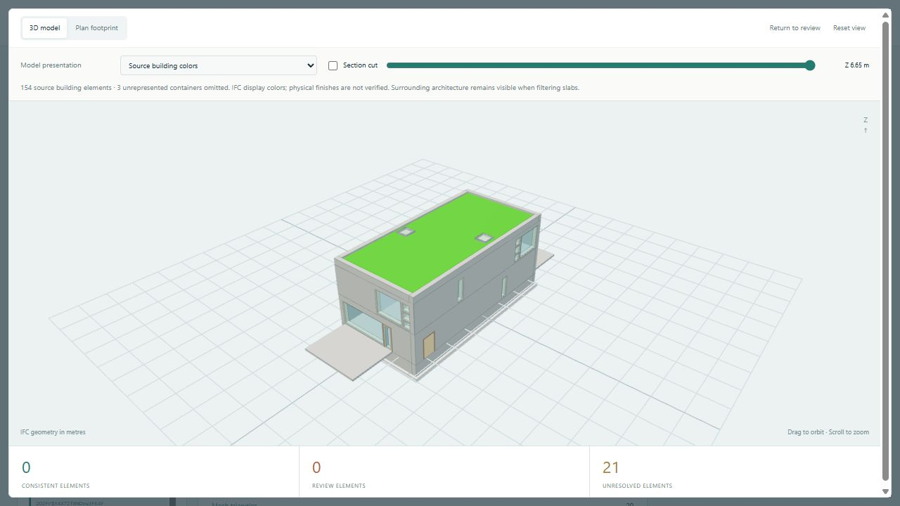
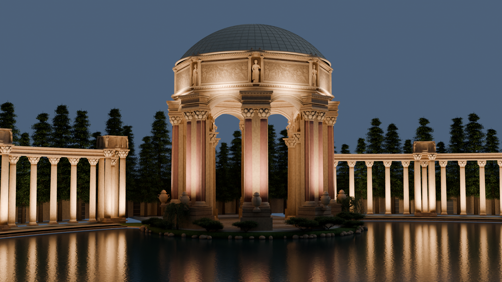
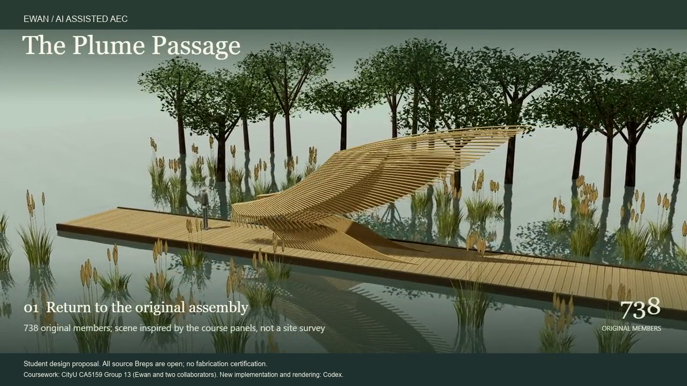
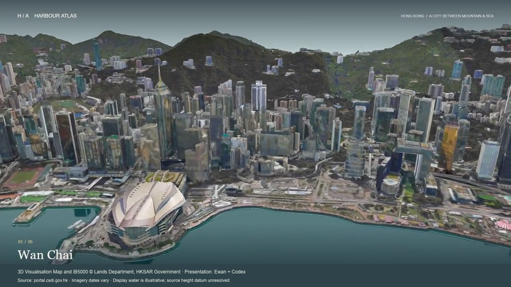

# Ewan

**Urban design · Civil engineering · Spatial analysis**

I am an urban design postgraduate at City University of Hong Kong. My civil engineering background comes from Chang'an University.
I use design and spatial analysis to define practical questions. My projects combine models, software prototypes, and source-based reviews.

[Explore the portfolio](portfolio/README.md) · [Quant trading engineering project](https://github.com/Lucyprivate/quant-trading-system)

## Latest study: Hong Kong Urban Site Study

*Local Rhino 8.6 viewport capture, 14 October 2026. This 3,840 × 1,968 image shows an urban river district. It is separate from the controlled benchmark images.*

The **[Hong Kong Urban Site Study](https://github.com/Lucyprivate/hong-kong-urban-site-study)** examines a 10 × 10 km area.
It connects historical urban form, building-height evidence, terrain, roads, and railways.
The model retains black building attributes, gray terrain, and blue water across **100 blocks of 1 × 1 km**.
The latest model retains saved render caches. Its geometry simplification stays within a documented error bound.

Three same-period **Rhino 8** runs compared each model.
The final model's first shaded view was about **34% quicker** than the river-optimized comparison model.
Orbit drawing was about **7% quicker**. Opening alone remained slower.
These small samples describe the tested models and settings.
The [performance notes](https://github.com/Lucyprivate/hong-kong-urban-site-study/blob/main/docs/model-performance.md) retain the full comparisons and limits.

The study develops shared source materials. Ewan set the brief, supplied resources, and directed revisions.
Transport elevations and supports include estimates. The project records unresolved height relationships.
Models and raw data remain local. **Work in progress · Visual snapshot: 14 October 2026.**

[中文说明](https://github.com/Lucyprivate/hong-kong-urban-site-study/blob/main/README.zh-CN.md) · [Model and preview](https://github.com/Lucyprivate/hong-kong-urban-site-study/blob/main/docs/model-and-preview.md) · [Validation](https://github.com/Lucyprivate/hong-kong-urban-site-study/blob/main/docs/validation.md) · [Road and rail view](https://github.com/Lucyprivate/hong-kong-urban-site-study/blob/main/images/model-interchange-20261014.png)

## Selected work

| Evidence and design review | Architectural and urban visualization |
|---|---|
|  |  |
| **[Void-Aware IFC Review](portfolio/ifc-review.md)**: openings, quantity units, and missing evidence. | **[Palace of Fine Arts](portfolio/palace.md)**: reference sources and a 36-second film. |
|  |  |
| **[The Plume Passage](portfolio/plume.md)**: source assembly and buildability limits. | **[Harbour Atlas](portfolio/harbour.md)**: official city data and a 60-second film. |

## Project method

1. Define the project question.
2. Use the original model or a traceable source.
3. Record assumptions, source limits, and failed checks.

Ewan's original Plume contribution was **Grasshopper component-network assembly**.
The portfolio extensions add software prototypes, automated checks, and rendered views.
These research prototypes do not certify construction or regulatory compliance.

## Other engineering work

The [Quant Trading System](https://github.com/Lucyprivate/quant-trading-system) grew from a manual limit-order workflow into a modular Python project.
It combines strategy modules, backtesting, asynchronous execution, monitoring, and risk controls.
The public case study documents architecture and development methods.
It omits account data and proprietary strategy parameters.

[Read the engineering introduction and stack](portfolio/quant-engineering.md).

[Home Network Infra](https://github.com/Lucyprivate/home-network-infra) documents a segmented home network with Proxmox, OpenWrt, Headscale, and self-hosted services.
It includes recovery procedures and device-specific Windows access controls.
The public release contains anonymized examples and offline checks.

## Background

**City University of Hong Kong**: Master of Urban Design and Regional Planning, expected June 2027.

**Chang'an University**: Bachelor of Engineering, Road, Bridge and River-crossing Engineering, 2025.

Rhino / Grasshopper component networks · Geographic information systems (GIS) · spatial analysis · engineering calculations · Python / JavaScript prototypes.

This portfolio contains case studies, images, and films.
It excludes model files, geometry datasets, and private application documents.
[Credits and source notes](portfolio/CREDITS.md).
