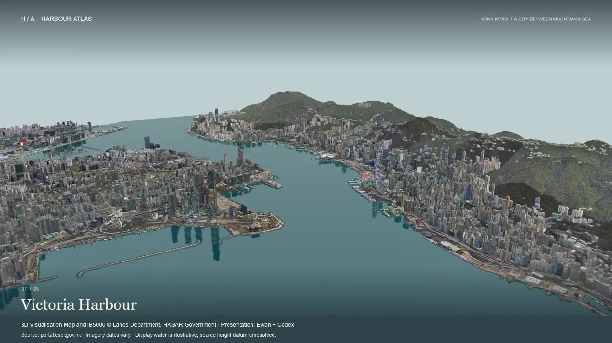

# Harbour Atlas

**Hong Kong's photographic city surface with visible source records.**

[Watch the 60-second film](media/harbour.mp4)

## Goal and source

The study presents the Lands Department's official 3D Visualisation Map.
It retains source texture coordinates and photographic appearance.
The source collection contains **2,302 tiles**.
The presentation uses **2,197 tiles** and **2,240 original texture images**.
It separates detailed landmark regions from coarser context.

## Method and limits

A derivative of the official mapped water forms a continuous display surface.
The raw-source mode retains the original photographic water.
The selected water height is a display parameter, rather than a measured tide.

The photographic source does not establish its vertical datum.
The terrain has a known Hong Kong Principal Datum (HKPD) reference.
The display keeps that terrain separate because the sources do not establish a common height datum.
Mixed revision dates do not establish each photograph's capture date or a present-day survey.

## Results

Local inspection examined browser views, source picking, and display modes.
A portable Rhino model visibly loaded its adjacent textures.
The film uses an actual **1,440-frame browser capture**.
The review decoded the full film and examined selected frames.
Texture seams, reconstruction roughness, and different levels of detail remain visible.

## Sources and contribution

**3D Visualisation Map and iB5000 © Lands Department, HKSAR Government.**
Source: portal.csdi.gov.hk.
Harbour Atlas adapts the source through reprojection and presentation changes.
Government ownership and source reuse terms still apply. The presentation does not imply endorsement.

Ewan set the project direction and supplied resources.
The work combines data collection tools, software, automated checks, and rendered views.
This page publishes images and the compact film.
It excludes city tiles, texture datasets, computer-aided design (CAD) files, and terrain data.

[Sources and reuse notes](CREDITS.md#harbour-data) · [Portfolio](README.md) · [Profile](../README.md)
