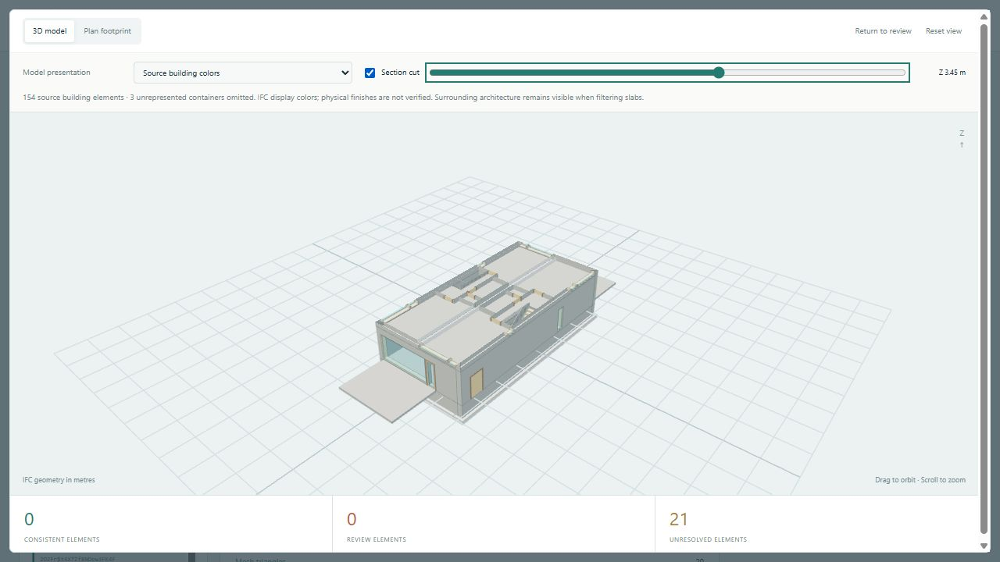

# Void-Aware IFC Review

**A quantity review that retains unresolved evidence.**

## Goal and method

The prototype examines slab areas in Industry Foundation Classes (IFC) models.
It compares a declared `NetArea` with geometry and quantity units.
The review subtracts openings and resolves quantity units separately from geometry coordinates.
It retains evidence for each element.
Missing quantities, ambiguous scope, and unsupported geometry cannot produce an automatic pass.

## Results

The public Duplex case retains **154 displayed building elements** from the source IFC.
It does not substitute a decorative model.
**21 slab comparisons remain unresolved** because the source lacks declared quantity evidence.
The sum of all slab layers does not establish building gross floor area.

The local evidence includes:

- 14 analytical IFC fixtures, 45 Python engine tests, and 5 display tests.
- A reproduced and repaired area-unit conversion failure.
- Source identity checks and 11 saved reports tied to their input, request, and engine.
- A reusable project procedure and a separately recorded trial of that procedure.

## Limits and contribution

The visual section clips the original context.
It does not change the IFC or the area-review result.
The display retains source colors. These colors do not establish physical finishes.
Software, fixtures, and models remain local in this presentation edition.

Ewan supplied the project direction and domain context.
The work combines a software prototype, automated checks, and source-based review.
The Duplex architecture is an external test model. Ewan did not design it.

**Source:** BSI (2020), “Duplex Apartment Test Files,” buildingSMART International, CC BY 4.0.
The screenshots show derived interface views. [Full attribution](CREDITS.md#ifc-reference).

[Portfolio](README.md) · [Profile](../README.md)
