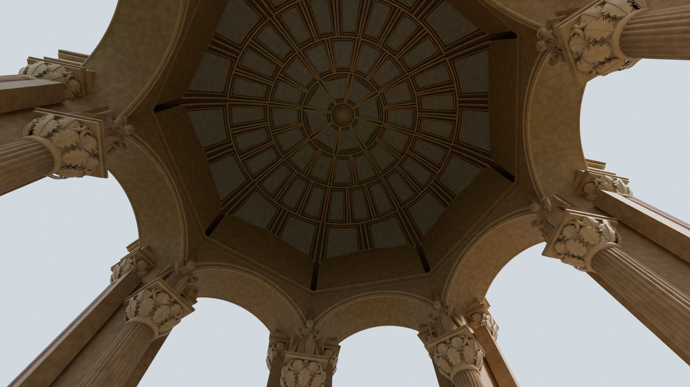

# Palace of Fine Arts

**An architectural reconstruction from reference sources.**

[Watch the 36-second film](media/palace.mp4)

## Goal and sources

The study examines the rotunda's scale, eight triangular piers, paired exterior columns, and curved colonnades.
Historical sources guide these features.
The **162-foot height** runs from the modeled rotunda floor to the dome apex.
This source dimension is separate from estimated local proportions and site geometry.

## Method

The refinement corrected the floor-height datum, column arrangement, paired roof urns, attic niches, arch openings, and lagoon relationships.
Daylight views complement the evening film and show materials and proportions.

The workflow combines a procedural Blender scene, rendered comparisons, and a geometry inspector.
Browser checks led to corrections in column shading and subpixel roof joints.
The review decoded all final film frames.
It also examined selected encoded images and shot endpoints.
These checks establish consistency in the tested output. They do not establish survey accuracy.

## Limits and contribution

The ornament, allegorical figures, vegetation, and parts of the site are interpretations.
The project relief texture does not represent measured sculpture depth.
The reconstruction does not represent a surveyed replica.

Ewan set the project brief and direction.
The work combines source research, software development, and rendered views.
The page publishes original project renders and the compact film.
It excludes Blender, Rhino, and browser model files.

[Reference sources](CREDITS.md#palace-references) · [Portfolio](README.md) · [Profile](../README.md)
