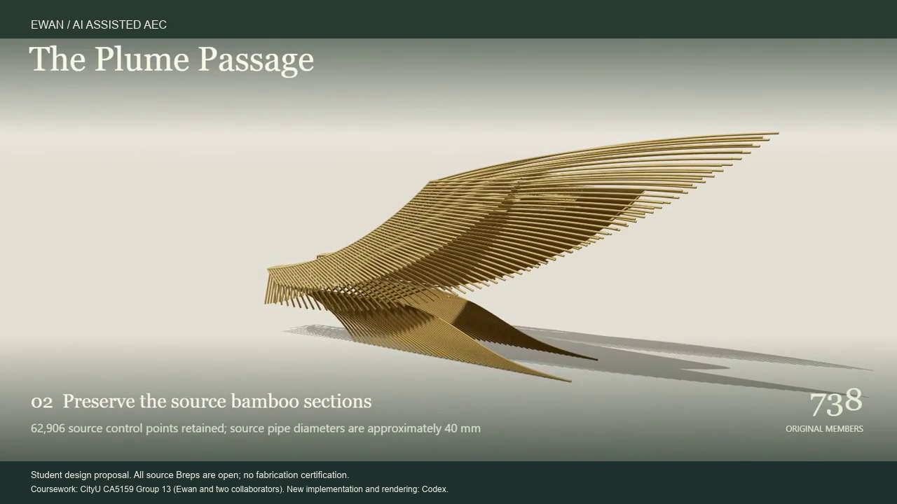

# The Plume Passage

**Preserve the shared original assembly before examining a new constraint.**

[Watch the 24-second film](media/plume.mp4)

## Goal and contribution

Ewan and two collaborators developed the original Plume Passage proposal.
Ewan assembled its **Grasshopper component network**.
The later extension adds inspection, reports linked to the source, and a recorded review workflow.

## Source identity

The local source edition retains **738 original Rhino surface members** and their identities.
All **62,906 audited surface and edge control points** match after the documented rigid recentering.
The display uses meshes from the trimmed source surfaces.
It does not sample the untrimmed underlying surfaces.

The source boundary representations (Breps) remain open.
The study does not claim invented end caps, construction connections, or structural performance.

## Experiment and limits

A historical affine widening clears an added illustrative passage target.
But it distorts bamboo sections to a measured diameter ratio of about **1.651:1**.
Zero mesh interference does not prove buildability.
The original assembly remains the primary design. The widened version remains an experiment.

Input checks reject empty or invalid models before design checks.
The local project retains **20 JavaScript tests** and **8 Python tests**.
It records a correction that ties each report to its computer-aided design (CAD) input.

The wetland setting uses the original presentation panels as a visual reference.
It does not represent a surveyed site.
The extension combines software, automated checks, and rendered views.
This public edition excludes model and geometry files.

[Credits](CREDITS.md#the-plume-passage) · [Portfolio](README.md) · [Profile](../README.md)
